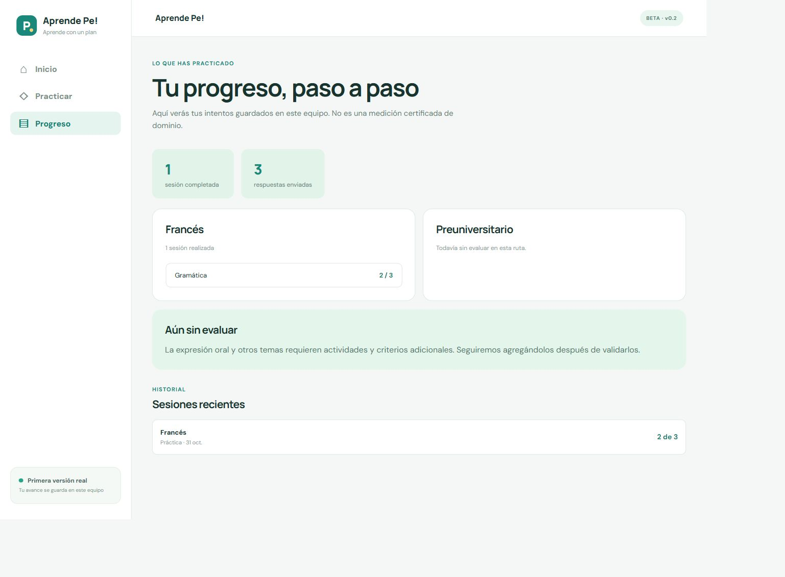

# Aprende Pe!

Aprende Pe! es una app de práctica para estudiantes. Su primera versión ejecutable permite elegir entre francés y biología preuniversitaria, responder ejercicios, revisar cada error y consultar intentos anteriores. Conservamos las dos rutas mientras comparamos con estudiantes y docentes cuál desarrollar primero.

## Abrir la app

Necesitas Node.js. En la raíz del repositorio:

```powershell
npm run dev
```

Abre **http://localhost:4173** en el navegador. Si otra copia sigue usando ese puerto, ciérrala desde su terminal. Para ejecutar una copia de prueba en paralelo usa un archivo de datos distinto: `$env:PORT=4174; $env:DATA_FILE='data/prueba-4174.json'; npm run dev` y abre `http://localhost:4174`. Ejecuta `npm test` para verificar la lógica y la API. No hay paquetes externos que instalar.

La interfaz está preparada como PWA: tiene manifiesto, iconos y pantalla adaptable a celular y laptop. En `localhost` se puede probar la instalación en navegadores compatibles; para abrirla desde un teléfono distinto al equipo servidor hará falta desplegarla en HTTPS. La caché cubre archivos de la interfaz, **no** la API: responder preguntas exige conexión con el servidor.

## Lo que funciona en v0.2

- Servidor local con API para crear sesiones, recibir respuestas, corregirlas y guardar resultados.
- Perfil de invitado mediante una cookie de este navegador. El historial y los intentos se guardan en `data/aprende-pe.json` del equipo que ejecuta el servidor y sobreviven a reinicios.
- Reanudación de una sesión incompleta después de recargar la página.
- Práctica con corrección inmediata; diagnóstico y mini simulacro con corrección al final. El mini simulacro tiene un temporizador de cinco minutos controlado por el servidor.
- Resumen por habilidad e historial. Las claves y explicaciones permanecen en el servidor hasta que corresponde mostrarlas.
- Francés: gramática, lectura y comprensión oral con voz sintética del navegador. Preuniversitario: biología inicial.

El banco actual tiene preguntas originales **pendientes de revisión docente**. No representa un examen oficial, un nivel MCER certificado ni una predicción de admisión. Una sola sesión no basta para afirmar una falencia estable. Todavía no hay cuentas, sincronización entre dispositivos, IA conectada, evaluación de speaking o revisión de pronunciación. Borrar la cookie puede dejar inaccesible el perfil de invitado; el archivo de datos local no se publica en GitHub.



## Estructura para continuar

| Ruta | Función |
| --- | --- |
| `web/` | Interfaz, PWA e iconos |
| `server.mjs` y `lib/` | Servidor, API y persistencia local |
| `content/questions.js` | Banco inicial y soluciones; no se sirve como archivo público |
| `tests/` | Pruebas de evaluación, API y persistencia |
| `docs/` | Visión, decisiones, diseño y traspaso a Claude Code |

Para añadir preguntas, edita `content/questions.js` con `id` único, ruta, habilidad, enunciado, opciones, `correctIndex`, explicación y siguiente paso. Haz revisar la clave y la explicación por un docente antes de usarlas para evaluar estudiantes. Las preguntas de admisión deben tener metadatos versionados de universidad, proceso y área antes de afirmar cobertura específica.

## Colaboración

Repositorio: [MarcoPorras123/aprende-pe](https://github.com/MarcoPorras123/aprende-pe). El socio `Artanis1510` puede participar desde GitHub. El [Figma público de lectura](https://www.figma.com/design/WlPe9XTto9rt2RxsDeuJQ5/Aprende-Pe--%C2%B7-Cascar%C3%B3n-v0.1?node-id=4-25) sigue siendo la referencia visual; editarlo requiere invitación en Figma. Consulta [la visión](docs/vision.md), [las decisiones](docs/decisiones.md) y [el contexto para Claude Code](CLAUDE.md).
