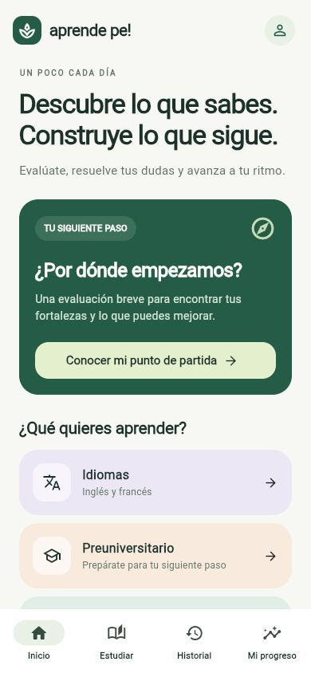
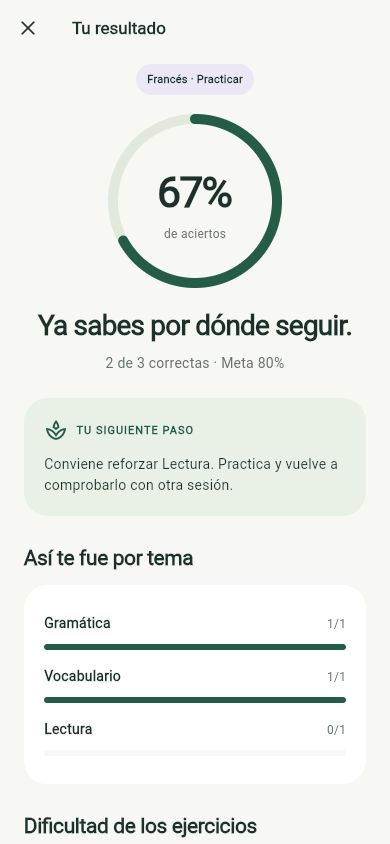

# Aprende Pe!

Aplicación de estudio con **Flutter para Android e iOS** y un servidor Node.js que prepara sesiones, guarda respuestas y calcula los resultados. El estudiante elige qué quiere estudiar, se evalúa, practica un tema y vuelve a comprobarlo con preguntas distintas.

**Versión 0.4.0 · avances al 5 de noviembre de 2026.** La app Android se ha compilado y el proyecto iOS está incluido. Sigue siendo una versión de desarrollo con contenido de muestra: no es una certificación de idiomas ni un simulacro oficial de admisión.

<p>
  
  
</p>

## Avances y funciones nuevas

| Función | Comportamiento actual |
| --- | --- |
| App móvil Flutter | Widgets Dart compartidos entre Android e iOS, navegación inferior y controles en español. Incluye inicio, estudio, historial, progreso y conexión. |
| Áreas de estudio | Idiomas —inglés y francés—, preuniversitario y universitario. Las áreas y los modos de trabajo se seleccionan por separado. |
| Evaluarme | Preguntas sin pistas durante el intento; respuestas correctas y explicaciones al finalizar. |
| Practicar un tema | Corrección inmediata, explicación, concepto o fórmula y una actividad recomendada después de responder. |
| Simulacro general | Sesión con tiempo límite controlado por el servidor. Salir de la app no pausa el reloj. |
| Configuración guiada | Curso, tema, dificultad de los ejercicios, 3/6/10 preguntas, meta de 70/80/90% y duración de 5/10/20 minutos. |
| Tipos de respuesta | Alternativas y respuestas numéricas en actividades compatibles del catálogo. La generación con IA produce alternativas. |
| Preguntas nuevas | Exclusión persistente de preguntas de muestra ya asignadas al mismo perfil. Si se agotan, se pide ampliar el alcance en lugar de repetirlas. |
| Resultados y siguiente paso | Aciertos por habilidad y dificultad presentada, pendientes, revisión de cada respuesta y acceso a practicar el tema del error. |
| Guardar y continuar | Perfil de invitado, historial y recuperación de sesiones. Solicitudes idempotentes y recuperación de respuestas cuyo envío se interrumpió. |
| Tutor por ejercicio | Explicaciones del catálogo en modo muestra; adaptador de tutoría con IA para sesiones generadas, sujeto a disponibilidad del servidor. |
| Integración de IA | Adaptador OpenAI del lado del servidor, salida estructurada y segunda revisión automática antes de abrir un examen. Permite cursos/temas escritos por el estudiante al elegir IA. |

La meta es personal: alcanzar el 80% **no cambia automáticamente el nivel**. El porcentaje corresponde a los ejercicios presentados. La muestra de idiomas contiene A1, A2 y B1; seleccionar dificultad no equivale a diagnosticar un nivel MCER global.

## Estado real de la entrega

- **Android:** APK debug compilado e instalado en un emulador; falta completar la revisión interactiva nativa y las pruebas en teléfonos físicos. El APK se genera localmente, no se guarda en Git.
- **iOS:** proyecto, iconos y configuración de Keychain incluidos. Falta compilarlo y probarlo en macOS con Xcode.
- **Vista previa Flutter:** compilada y probada contra el servidor local en una pantalla de 390 × 844. Se comprobó una práctica completa, su explicación, recuperación tras recargar y resultado de 2/3 aciertos.
- **IA:** el adaptador está implementado y tiene pruebas con respuestas simuladas. La primera solicitud real fue rechazada con `credit_balance_exhausted`; todavía falta validar generación y tutoría reales de extremo a extremo con una credencial vigente y saldo disponible.
- **Distribución:** sin publicación en Play Store/App Store ni backend público. La app necesita conexión con su servidor para realizar actividades.

Consulta el [detalle de avances](docs/avances-v04.md) y la [validación móvil](mobile/VALIDACION.md).

## Ejecutar el servidor

Requiere Node.js 22.15 o posterior. Desde la raíz del repositorio:

```powershell
npm start
```

El servidor escucha en **http://127.0.0.1:4174**. No necesita instalar paquetes npm. La interfaz web de desarrollo también se conserva en esa dirección. `HOST`, `PORT` y `DATA_FILE` permiten configurar el proceso; por defecto solo escucha en la computadora local.

Los datos se guardan en `data/aprende-pe.json`, excluido de Git. La API nueva utiliza `/api/v3/`; la API anterior se conserva para compatibilidad. Los intentos antiguos no se convierten automáticamente en sesiones de la nueva interfaz.

## Ejecutar la aplicación móvil

Abrir `mobile/` en Android Studio o VS Code. Entorno utilizado: Flutter 3.47.9 / Dart 3.13.7. Las dependencias se fijan en `mobile/pubspec.lock`.

```powershell
cd mobile
flutter pub get
flutter run --dart-define=API_BASE_URL=http://10.0.2.2:4174
```

`10.0.2.2` permite que el **emulador Android** acceda al servidor de la computadora. Para un teléfono Android conectado por USB, usar `adb reverse tcp:4174 tcp:4174` y seleccionar `http://127.0.0.1:4174` en **Conexión y perfil**. El backend debe seguir encendido. Para distribución y para iOS se utiliza un servidor HTTPS accesible.

Generar un APK de prueba:

```powershell
flutter build apk --debug --dart-define=API_BASE_URL=http://10.0.2.2:4174
```

Salida: `mobile/build/app/outputs/flutter-apk/app-debug.apk`. Es una compilación con firma de desarrollo; antes de publicar se necesitan identificadores y firma propios.

En macOS, abrir `mobile/ios/Runner.xcworkspace`, configurar el equipo de Apple y ejecutar con un backend HTTPS. Ver la [guía móvil](mobile/README.md) y las [instrucciones oficiales de iOS](https://docs.flutter.dev/deployment/ios).

### Vista previa del mismo código Flutter

Con el backend ejecutándose en 4174, en otra terminal:

```powershell
cd mobile
flutter build web --release --no-web-resources-cdn
node tool/preview.mjs
```

Abrir **http://127.0.0.1:4175**. Este destino web facilita revisar los mismos widgets del cliente móvil. El perfil del navegador y el de cada instalación móvil son independientes; aún no hay cuentas para sincronizarlos.

## Configurar IA en el servidor

Copiar `.env.example` a `.env` en la raíz y configurar localmente `OPENAI_API_KEY`, un `OPENAI_MODEL` compatible con Responses/salidas estructuradas y `AI_ENABLED=1`. Reiniciar el servidor. No poner la clave en Flutter, en parámetros de compilación, en el navegador ni en Git.

La etiqueta **IA configurada** solo confirma que existen los parámetros necesarios. La disponibilidad requiere credencial vigente, permisos sobre el modelo y crédito. Si hay errores de autenticación, cuota o formato, se muestran sin sustituir silenciosamente la sesión por contenido de muestra.

La generación realiza dos solicitudes: creación y revisión automática. Las consultas al tutor pueden realizar solicitudes adicionales. `AI_DAILY_REQUEST_LIMIT` limita solicitudes por perfil/día y proceso; se reinicia con el servidor y **no es un límite financiero ni una protección de producción**. La revisión automática no sustituye la revisión docente.

Se evita la repetición exacta dentro del historial del perfil; la revisión semántica considera las últimas 80 preguntas y no garantiza novedad ilimitada. El modo de muestra funciona sin configurar IA.

## Pruebas

```powershell
# En la raíz: 14 pruebas del servidor y la lógica
npm test

# En mobile/: análisis y 10 pruebas del cliente
cd mobile
flutter analyze
flutter test
```

Se comprueban separación de modos, respuestas ocultas, exclusión de preguntas, validación de entradas, idempotencia, persistencia, resultados inmutables, vencimiento y manejo de errores de IA. El cliente comprueba almacenamiento del perfil, aislamiento por servidor, errores de conexión, recuperación y recorridos en pantalla móvil. Las pruebas de IA no hacen llamadas pagadas.

## Pendiente antes de producción

- Revisión docente del banco, claves, dificultad, explicaciones y rúbricas; validación de cualquier estimación de nivel.
- Modelos oficiales versionados de universidades y exámenes de idiomas. Actualmente solo hay simulacros generales.
- Evaluación de audios, pronunciación, escritura y comprensión auditiva validada. La grabación de ensayo local de la web no se ha trasladado a Flutter.
- Cuentas recuperables y sincronización entre dispositivos, políticas de datos y eliminación de perfiles.
- Backend HTTPS desplegado, base de datos transaccional y cuotas persistentes; el almacén JSON actual es para pruebas locales de un solo proceso.
- Verificación real de IA, pruebas completas en Android/iOS y firma/publicación en tiendas.

## Estructura y colaboración

| Ruta | Función |
| --- | --- |
| `mobile/` | Aplicación Flutter y proyectos Android/iOS |
| `server.mjs`, `lib/` | Servidor, API, corrección, persistencia y adaptador de IA |
| `web/` | Interfaz web de desarrollo y compatibilidad |
| `content/` | Banco inicial de la API anterior; claves fuera de archivos públicos |
| `tests/`, `mobile/test/` | Pruebas del backend y del cliente móvil |
| `docs/` | Avances, capturas, decisiones y antecedentes del producto |

Repositorio: [MarcoPorras123/aprende-pe](https://github.com/MarcoPorras123/aprende-pe). Lee [CLAUDE.md](CLAUDE.md), [las decisiones](docs/decisiones.md) y [los avances v0.4](docs/avances-v04.md) para continuar. La [visión inicial](docs/vision.md) y el [Figma del cascarón](https://www.figma.com/design/WlPe9XTto9rt2RxsDeuJQ5/Aprende-Pe--%C2%B7-Cascar%C3%B3n-v0.1?node-id=4-25) se conservan como antecedentes; sus descripciones de estado previas quedan actualizadas por este README y las decisiones recientes. La interfaz Flutter todavía no se ha sincronizado con ese Figma.
