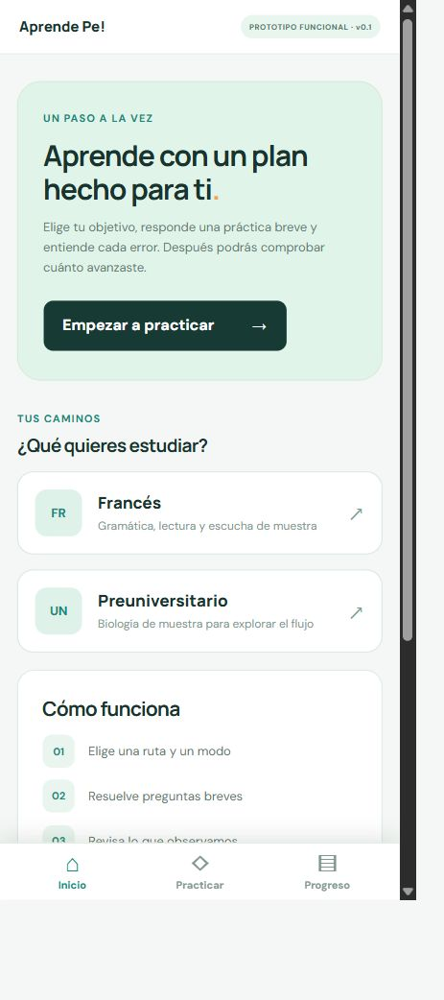
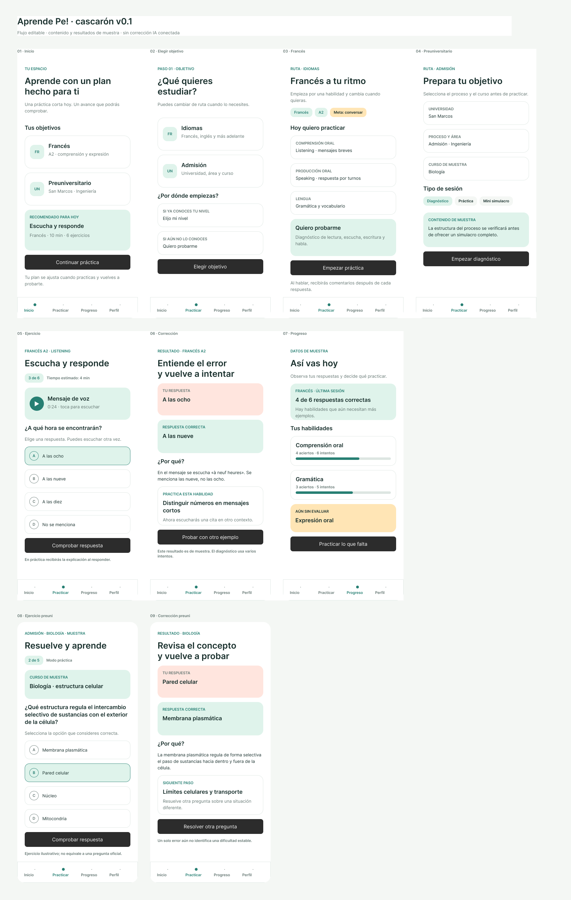

# Aprende Pe!

Aprende Pe! es una idea de app para estudiantes: plantea una meta, practica con ejercicios, explica errores y vuelve a comprobar el progreso. Estamos comparando dos primeras rutas —idiomas y preparación preuniversitaria— antes de elegir el primer producto completo.

**Estado (31 de octubre de 2026):** primera aplicación web ejecutable para probar el recorrido con francés y biología preuniversitaria. También se conserva el cascarón editable en Figma. Las preguntas son originales de demostración; todavía no hay banco revisado por docentes, cuentas, backend ni corrección mediante IA.

- [Abrir el diseño editable en Figma](https://www.figma.com/design/WlPe9XTto9rt2RxsDeuJQ5)
- [Leer la visión y la evaluación de viabilidad](docs/vision.md)
- [Revisar las pantallas y lo que representan](docs/cascaron.md)
- [Ver decisiones y preguntas abiertas](docs/decisiones.md)
- [Continuar el proyecto en Claude Code](docs/traspaso-claude-code.md)

## Probar la primera app

Necesitas Node.js. En la raíz del repositorio:

```powershell
npm run dev
```

Abre `http://localhost:4173` en el navegador. No hay dependencias que instalar. Para comprobar la lógica de evaluación, ejecuta `npm test`.

Esta versión permite elegir francés o preuniversitario, seleccionar una habilidad y practicar con preguntas de muestra. La **práctica** explica cada respuesta inmediatamente; **Quiero probarme** reserva el feedback para el final; el **mini simulacro** hace lo mismo y añade un temporizador de muestra de cinco minutos. El historial se guarda en el almacenamiento local del navegador, en el dispositivo donde se usa. La comprensión oral usa la voz sintética disponible en el navegador y puede variar según el equipo. Speaking, evaluación de pronunciación, IA, sincronización entre dispositivos y un examen oficial aún no están implementados.





## Recorrido incluido

El Figma muestra inicio, elección de objetivo, configuración de francés, configuración de preuniversitario, ejercicios y correcciones de muestra para ambas rutas, y una vista de progreso. La aplicación web inicial convierte parte de ese recorrido en una prueba funcional para discutirlo con estudiantes y docentes.

## Cómo colaborar

Usaremos los issues para discutir cambios pequeños y registraremos aquí las decisiones aceptadas. Antes de construir la primera versión, compararemos ambas rutas con estudiantes y docentes. El objetivo es elegir un alcance que podamos probar con contenido revisado.
