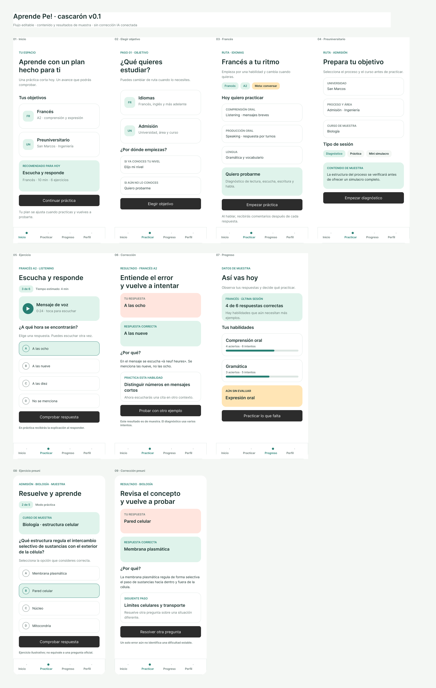

# Aprende Pe!

Aprende Pe! es una idea de app para estudiantes: plantea una meta, practica con ejercicios, explica errores y vuelve a comprobar el progreso. Estamos comparando dos primeras rutas —idiomas y preparación preuniversitaria— antes de elegir el primer producto completo.

**Estado (23 de octubre de 2026):** cascarón editable en Figma. Las preguntas, resultados y tiempos son ejemplos; aún no hay app ejecutable, audio funcional ni corrección mediante IA.

- [Abrir el diseño editable en Figma](https://www.figma.com/design/WlPe9XTto9rt2RxsDeuJQ5)
- [Leer la visión y la evaluación de viabilidad](docs/vision.md)
- [Revisar las pantallas y lo que representan](docs/cascaron.md)
- [Ver decisiones y preguntas abiertas](docs/decisiones.md)

## Recorrido incluido

El diseño muestra inicio, elección de objetivo, configuración de francés, configuración de preuniversitario, ejercicios y correcciones de muestra para ambas rutas, y una vista de progreso. Los modos propuestos distinguen diagnóstico, práctica con corrección tras cada respuesta y mini simulacro con explicación al final.

## Cómo colaborar

Usaremos los issues para discutir cambios pequeños y registraremos aquí las decisiones aceptadas. Antes de construir la primera versión, compararemos ambas rutas con estudiantes y docentes. El objetivo es elegir un alcance que podamos probar con contenido revisado.
